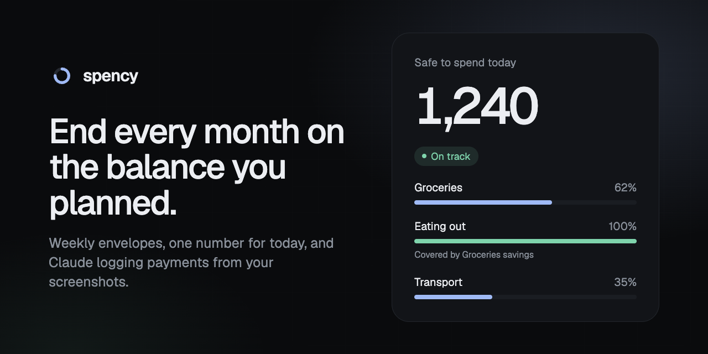

# Spency

A calm spending tracker that keeps you on course for the month-end balance you planned, kept up to date by Claude.

[](https://github.com/apurvamukherjee/spency-pocket-wallet/actions/workflows/ci.yml)
[](LICENSE)



```bash
git clone https://github.com/apurvamukherjee/spency-pocket-wallet.git && cd spency-pocket-wallet && npm install && npm run dev
```

<p>
  
  
  
</p>


> **Status:** Phase 2 (accounts and sync) is built and in review. The Claude connector (Phase 3) is next. See the [roadmap](#roadmap).

## What it does

You tell Spency your balance today and the balance you want at month-end. It sets aside your bills, splits the rest into weekly envelopes (groceries, eating out, transport…) plus a flex pool, and gives you one number each morning: **how much is safe to spend today**.

- **Overspending is handled for you.** Go over on one envelope and Spency covers it from what you saved in others, then from flex, and only then from your month-end target. It tells you plainly: "You went $15 over on Coffee, and all of it was covered because you spent less on Groceries."
- **Projected month-end** against your target, updated with every payment.
- **Inbox** of payments Claude read from your screenshots. Swipe right to confirm, left to dismiss. Duplicates are flagged.
- **Merchant memory.** Recategorize a shop once; future payments there land in the right envelope.
- **Cash** withdrawals are transfers, not spending. Cash purchases still count toward envelopes.
- **Daily reconcile** against your real bank balance, with a streak.
- **Works everywhere.** Any currency, number format and time zone. Dark mode by default, light mode in Settings.
- **Private by design.** Spency never asks for bank logins. It only knows what you or Claude tell it.

## Spency as Claude's wallet

The point is that you don't type transactions in. Claude does.

```
 You ──(payment screenshot)──▶ Claude
                                 │  reads merchant, amount, time, reference
                                 ▼
                      Spency connector (MCP) ──▶ Inbox (pending)
                                                    │ swipe to confirm
                                                    ▼
                                    envelopes · flex · month-end projection
```

1. Add Spency to Claude as a **custom connector**: a remote MCP server on the same deployment. You sign in once, so your Claude is tied to your Spency account.
2. Drop payment screenshots into any Claude chat. Claude extracts the merchant, amount, time and reference, maps them to your envelope names, and sends them over.
3. Everything Claude sends lands in your Inbox as **pending**. Nothing touches your balances until you confirm it.
4. Ask Claude things like *"Can I afford a $60 dinner tonight?"* and it answers from your real numbers.

Planned tools: `get_summary`, `add_transactions` (deduplicated by payment reference), `list_transactions`, `update_envelope`, `add_commitment`, `log_cash`, `reconcile`. Shipping in Phase 3.

## Run it

**Demo mode (no setup):** `npm install && npm run dev`, then open http://localhost:3000. You get a sample month stored in your browser.

**With accounts:** Spency uses [Supabase](https://supabase.com) for Postgres and auth.

1. Create a free Supabase project.
2. `cp .env.example .env.local` and fill in `NEXT_PUBLIC_SUPABASE_URL` and `NEXT_PUBLIC_SUPABASE_PUBLISHABLE_KEY` (Project Settings → API).
3. Apply the schema:
   ```bash
   npx supabase login
   npx supabase link --project-ref <your-project-ref>
   npx supabase db push --remote
   ```
4. In Supabase → Authentication → URL Configuration, set the Site URL and add `<your-site>/auth/confirm` to the redirect URLs.
5. `npm run dev`, then create an account.

```bash
npm test           # engine tests
npm run typecheck
npm run lint
npm run build
```

## How the numbers work

Everything shown is derived from the month plan plus confirmed transactions, in integer minor units (cents, paise, yen). The engine is plain TypeScript in [`lib/engine`](lib/engine) with no framework imports, covered by Vitest.

- `spendable = bank + cash − target (+ pay still due this month)`
- `flex = spendable − bills this month − envelope allocation`
- Envelope allocation is prorated by day: `weekly limit / 7 × days of each week inside the month`, rounded to a whole unit of your currency.
- `projected month-end = money now + pay still due − bills still due − envelope money left − unused flex`. If you spend exactly to plan, this equals your target.

## Architecture

One Next.js 16 app serves the UI, the server actions and (from Phase 3) the MCP server.

| Layer | Where | Notes |
|---|---|---|
| Budget engine | `lib/engine/` | Pure functions: settlement, projection, proration, money formatting. |
| Data | `lib/data/` | Pure reducers shared by the local demo (Zustand) and the cloud (TanStack Query + Supabase, optimistic). |
| Database | `supabase/migrations/` | Postgres with row level security on every table; composite keys stop cross-user references. |
| Auth | `app/(auth)/`, `proxy.ts` | Email and password through Supabase; the proxy refreshes the session cookie. |
| UI | `app/(app)/`, `components/` | Tailwind CSS 4, hand-drawn icons and charts, native `<dialog>` sheets. |

## Roadmap

| Phase | What | State |
|---|---|---|
| 1 | Screens and weekly settlement engine on local data | done |
| 2 | Supabase schema, row level security, accounts, sync, any currency, light theme | done, in review |
| 3 | MCP server with OAuth, Claude connector setup guide | next |
| 4 | Pattern detection, rebalance suggestions, polish, accessibility | planned |

The full product spec is in [SPEC.md](SPEC.md) and the changes are in [CHANGELOG.md](CHANGELOG.md).

## Brand assets

The mark is a ring three-quarters full: on track. Sources live in [`docs/brand/`](docs/brand): `mark.svg`, `app-icon.html` (square app icons) and `share-card.html` (link previews), rendered to PNG with headless Chrome. Next.js picks up the tab icon, Apple touch icon, manifest and share images from `app/` automatically.

## Contributing

Issues and pull requests are welcome. Start with [CONTRIBUTING.md](CONTRIBUTING.md). Questions go to [Discussions](https://github.com/apurvamukherjee/spency-pocket-wallet/discussions).

## License

[MIT](LICENSE) © Apurva Mukherjee
