# Spency

**End every month on the number you chose.**

Spency is a budgeting app for people paid monthly. Tell it what's in the bank and what you want left at month end; every morning it gives you one number, **what's safe to spend today**, and Claude keeps it up to date by reading your payment screenshots.

[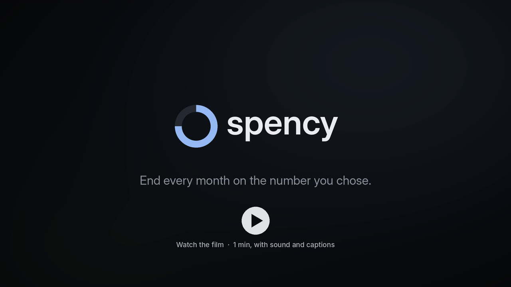](docs/spency-film.mp4)

**[Watch the film](docs/spency-film.mp4)** (1 min, with sound and captions) · **[Download it](https://github.com/apurvamukherjee/spency-pocket-wallet/raw/main/docs/spency-film.mp4)** · **[Try the live demo](https://spency-pocket-wallet-1ioz.vercel.app/login)** (no account needed: choose "Explore a demo month")

[](https://github.com/apurvamukherjee/spency-pocket-wallet/actions/workflows/ci.yml) [](LICENSE)

```bash
git clone https://github.com/apurvamukherjee/spency-pocket-wallet.git && cd spency-pocket-wallet && npm install && npm run dev
```


## Screens

<p>
  
  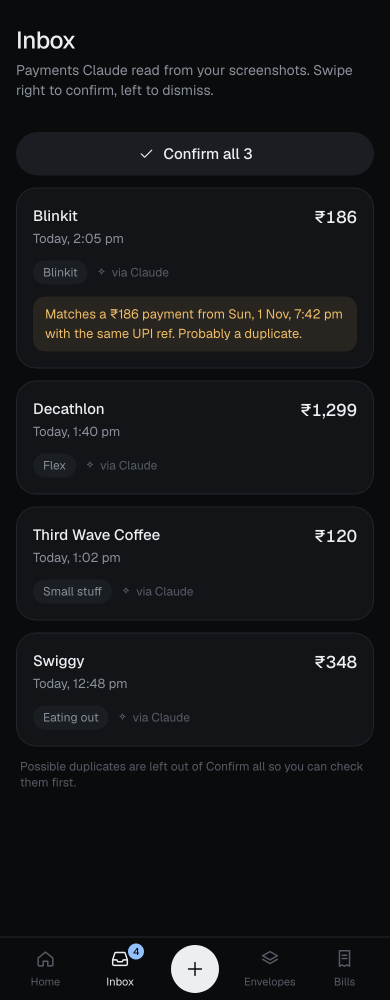
  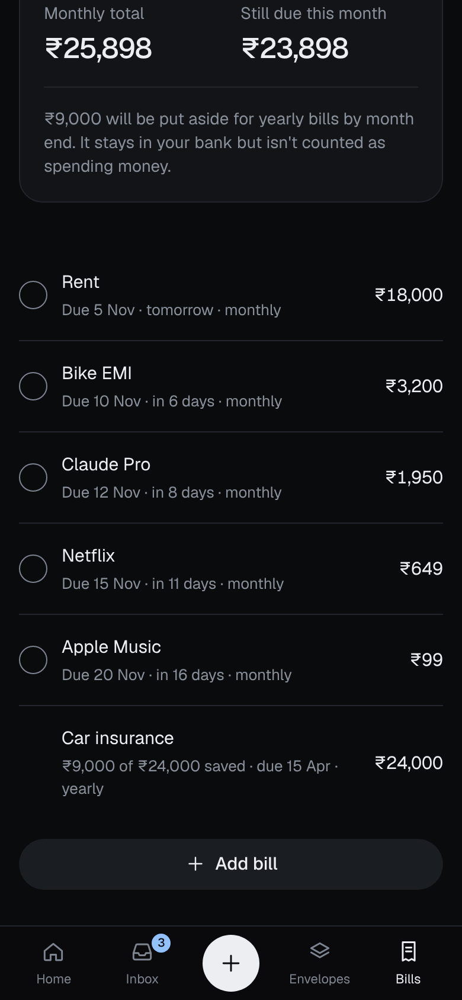
  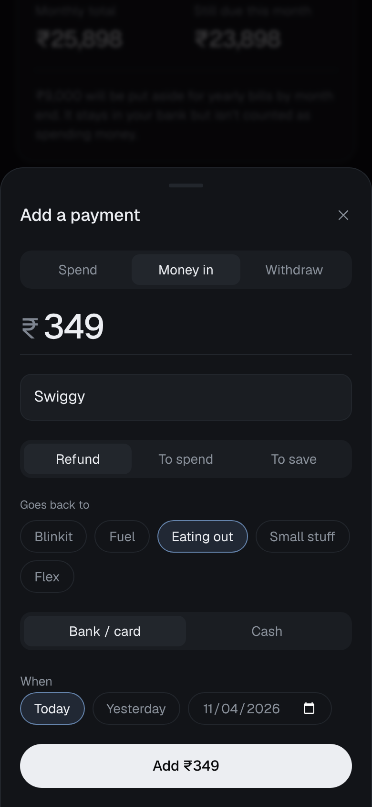
</p>
<p>
  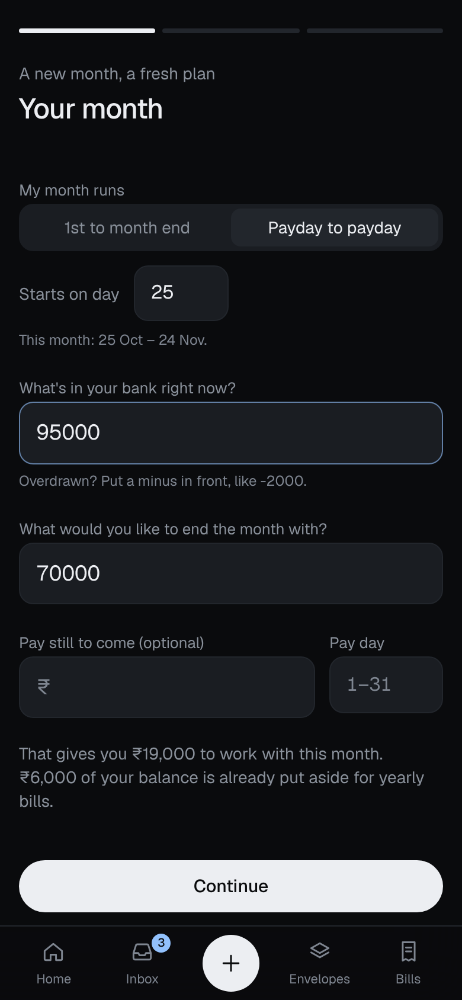
  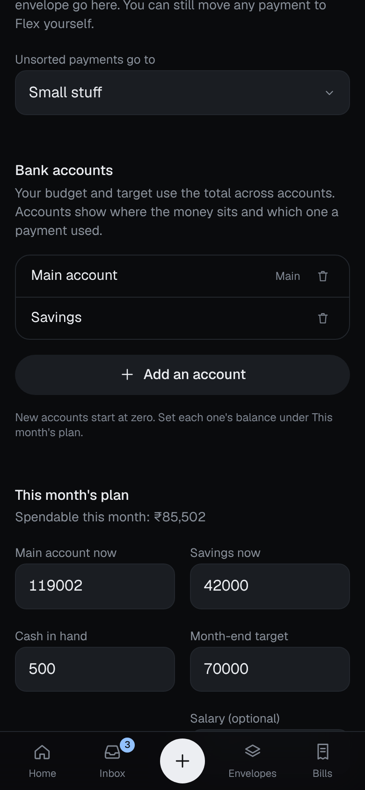
  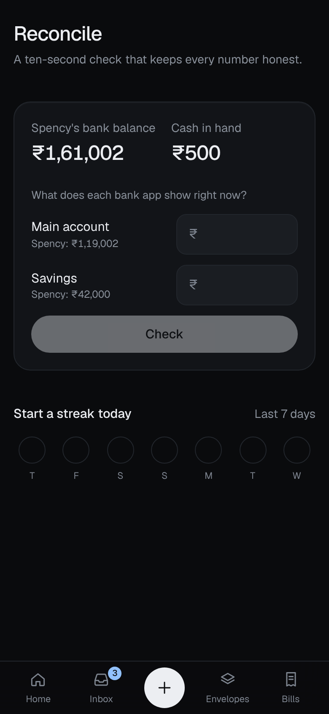
  
</p>


<details>
<summary>More: light desktop, sign-in, Settings</summary>

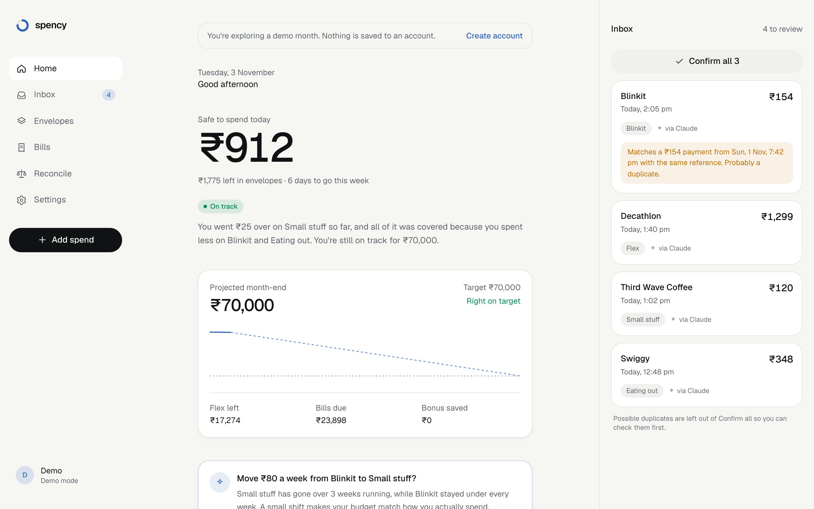

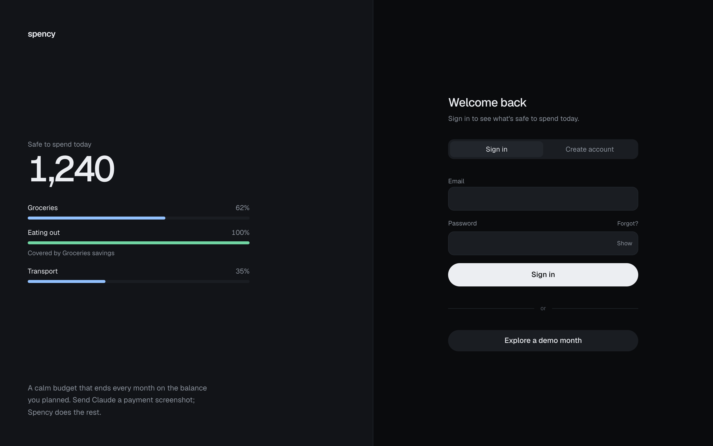

<p>
  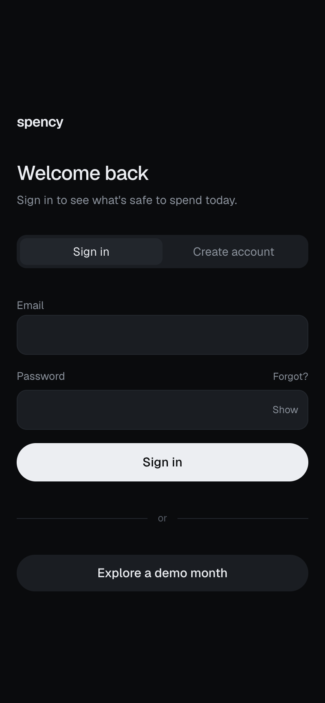
  
  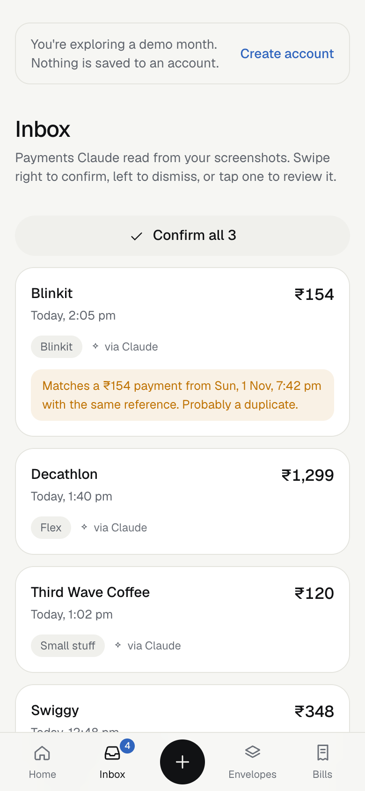
</p>
</details>

## Where it stands

v0.2.0 plus the unreleased work on `main` (see [CHANGELOG.md](CHANGELOG.md)): all four planned phases are built, and the app has since had a full bug review, speed work and a round of personal-finance improvements. It runs in production on Vercel and Supabase, with 178 tests (engine, MCP tools and row level security) in CI.

| Done | Next |
|---|---|
| Daily safe-to-spend, weekly envelopes, cover from savings, month-end projection | Credit cards, with card debt counted against the target |
| Claude connector over MCP with OAuth; Inbox with swipe to confirm | Month-by-month history and trends |
| Yearly-bill savings, refunds and extra income, overdrafts, payday-to-payday months, several bank accounts | |
| Server-rendered first load, one-request data loading, live updates | |

## What it does

You tell Spency your balance today and the balance you want at month end. It sets your bills aside, splits the rest into weekly envelopes (groceries, eating out, transport…) plus a flex pool, and gives you one number each morning.

**The daily number**
- **Safe to spend today**, with a plain-language line about the week: "You went ₹70 over on Small stuff, and all of it was covered because you spent less on Blinkit."
- **Overspending is handled for you.** Savings in other envelopes cover it first, then flex, and only then your month-end target.
- **Projected month end** against your target, updated with every payment. Off track? Spency says how much less a day gets you back, or kindly says when it can't happen this month.

**Claude does the typing**
- Send Claude a payment screenshot; it lands in your **Inbox**, live, without a refresh. Swipe right to confirm, left to dismiss. Likely duplicates are flagged.
- **Merchant memory**: recategorise a shop once and future payments there land in the right place. Nothing goes to Flex unless you choose it.
- Claude can answer "can I afford a ₹1,500 dinner?" and fix past mistakes when you ask.

**Real life, handled**
- **Months that match your pay**: run each month from payday to payday, or the 1st to the last day.
- **Yearly bills without the shock**: insurance or an annual plan is saved for a little each month.
- **Refunds go back** to the envelope they came from; **extra income** can be spent this month or saved.
- **Several bank accounts**: budget and target use the total, each payment shows its account, and moving money between your own accounts isn't spending.
- **Cash**: withdrawals are transfers, cash purchases still count toward envelopes.
- **Overdrawn?** Balances and targets can be negative, so you can plan your way out.
- **Bills you can tick off**, payments you can date (today, yesterday or any earlier day), and **rebalance suggestions** when one envelope keeps running over while another stays under.

**See what you're saving**
- **Savings tab**: what you've kept compared with your plan, day by day and week by week, which categories save the most, and a calculator: "spend 100 a week less" shows the extra this month, your new month end and the yearly total.

**Honest by design**
- **Daily reconcile** against each bank app, with a streak; gaps become adjustments on the right account.
- **Private**: Spency never asks for bank logins. It only knows what you or Claude tell it.
- **Works everywhere**: any currency, number format, time zone and week start. Dark by default, light in Settings.

## Spency as Claude's wallet

The point is that you don't type transactions in. Claude does.

```
 You ──(payment screenshot)──▶ Claude
                                 │  reads merchant, amount, time, reference, account
                                 ▼
                      Spency connector (MCP) ──▶ Inbox (pending, appears live)
                                                    │ swipe to confirm
                                                    ▼
                                    envelopes · flex · month-end projection
```

Spency runs a remote [MCP](https://modelcontextprotocol.io) server at `/api/mcp`. Claude signs in through OAuth (Supabase Auth is the authorization server), so it acts as you and row level security keeps it inside your own data.

| Tool | What Claude can do |
|---|---|
| `get_summary` | Safe to spend today, envelopes, flex, bills, yearly-bill savings, each bank account, projected month end, and how to get back on track. Answers "can I afford this?" |
| `get_savings` | Saved vs plan by day, week and category, plus a what-if: "what if I spent 100 a week less?" |
| `add_transactions` | Send payments read from screenshots to your Inbox as pending. Applies merchant memory, skips duplicates, files refunds back into their envelope, and takes the bank account when you have several. |
| `list_transactions` | Look up payments by date, status or category. |
| `log_cash` | Log a cash spend or a withdrawal (pending, like everything Claude adds). |
| `reconcile` | Compare your real bank balance with Spency's and help find the gap. |
| `update_transaction` / `remove_transaction` | Correct any payment, including past days (amount, merchant, category, account, date), or take a mistaken one out. |
| `add_commitment` / `update_commitment` / `remove_commitment` | Add, change or stop tracking a bill. |
| `set_bill_paid` | "Netflix hasn't gone out yet" or "rent is paid": sets a bill's status for this month. |
| `update_envelope` / `remove_envelope` | Change, create or delete an envelope; history moves to Flex. |
| `update_plan` | Change your target, pay day, week start, or reset balances to what you have now (negative if overdrawn). |

Claude can't confirm transactions for you: new payments wait in your Inbox until you swipe them in. It's told to check with you before removing anything or changing balances.

### Connect it to Claude

1. In Supabase → **Authentication → OAuth Server**: turn on the OAuth server, set **Authorization Path** to `/oauth/consent`, and turn on **Dynamic client registration**.
2. Make sure **Authentication → URL Configuration → Site URL** is your deployed Spency URL.
3. In Claude: **Settings → Connectors → Add custom connector**, name it Spency, URL `https://<your-spency>/api/mcp`. (Settings → Connect Claude in Spency shows the exact URL with a copy button.)
4. Claude opens Spency's consent page. Sign in, review what it can do, and Allow.
5. Drop a payment screenshot into any chat. It shows up in your Inbox.

Disconnect any time in Spency → Settings → Connected apps.

## Run it

**Demo mode (no setup):** `npm install && npm run dev`, then open http://localhost:3000. You get a sample month stored in your browser.

**With accounts:** Spency uses [Supabase](https://supabase.com) for Postgres, auth and live updates.

1. Create a free Supabase project.
2. `cp .env.example .env.local` and fill in `SUPABASE_URL` and `SUPABASE_PUBLISHABLE_KEY` (Project Settings → API).
3. Apply the schema (every file in [`supabase/migrations`](supabase/migrations), in order):
   ```bash
   npx supabase login
   npx supabase link --project-ref <your-project-ref>
   npx supabase db push --remote
   ```
4. In Supabase → Authentication → URL Configuration, set the Site URL and add `<your-site>/auth/confirm` to the redirect URLs.
5. `npm run dev`, then create an account.

```bash
npm test           # engine, MCP and row level security tests
npm run typecheck
npm run lint
npm run build
```

## Deploy to Vercel

1. Import the GitHub repo in Vercel (framework: Next.js, root `./`, Node 20+).
2. Project → Settings → Environment Variables, for Production, Preview and Development:

   | Name | Value |
   |---|---|
   | `SUPABASE_URL` | `https://<project-ref>.supabase.co` |
   | `SUPABASE_PUBLISHABLE_KEY` | the **publishable** key (never the secret / service_role key) |
   | `NEXT_PUBLIC_SITE_URL` | optional, only for a custom domain |

   The `NEXT_PUBLIC_` versions of the Supabase names work too. Values are read at build time, so redeploy after changing them.
3. Supabase → **Authentication → URL Configuration**: Site URL = your Vercel URL; add `https://<your-domain>/**` to Redirect URLs.
4. Supabase → **Authentication → Emails**: paste [`supabase/templates/confirmation.html`](supabase/templates/confirmation.html) into *Confirm signup* and [`recovery.html`](supabase/templates/recovery.html) into *Reset password*. Their links work on any device.
5. Supabase → **Authentication → OAuth Server**: enable it, Authorization Path `/oauth/consent`, dynamic client registration on (for the Claude connector).
6. Apply the schema: `npx supabase link --project-ref <ref>` then `npx supabase db push --remote`. Run it again whenever a release adds migrations.

Every push to `main` deploys. Check a deploy by opening the site (you should see "Welcome back", not "Accounts aren't set up here") and `https://<your-domain>/.well-known/oauth-protected-resource/api/mcp`, which should name your Supabase project.

The built-in Supabase email sender is rate-limited; for real users, set up custom SMTP in Authentication → Emails.

## How the numbers work

Everything shown is derived from the month plan plus confirmed transactions, in integer minor units (cents, paise, yen). The engine is plain TypeScript in [`lib/engine`](lib/engine) with no framework imports, covered by Vitest.

- **The month** runs from the plan's start day (the 1st, or your payday) to the day before the next one.
- `spendable = bank + cash − target − yearly-bill savings already held (+ pay still to come this month)`
- `flex = spendable − bills this month − this month's share of yearly bills − envelope allocation`
- **Yearly bills** set aside `(amount − saved) / months until due` each month, rounded up; the savings carry into the next month.
- **Envelope allocation** is prorated by day: `weekly limit / 7 × days of each week inside the month`, rounded to a whole unit of your currency.
- `projected month end = money now + pay still due − bills still due − yearly-bill savings held − envelope money left − unused flex`. Spend exactly to plan and this equals your target.
- **Savings**: each day's plan is the week's prorated envelope allocation spread over its days plus an even share of flex; `saved = planned − spent`. A what-if cut of `c` a week adds `c / 7 × days left` to projected month end.
- **Bank accounts** split the bank total; the main account holds whatever the others don't, so they always add up.

## Architecture

One Next.js 16 app serves the UI, the server actions and the MCP server.

| Layer | Where | Notes |
|---|---|---|
| Budget engine | `lib/engine/` | Pure functions: settlement, projection, proration, pay periods, yearly-bill savings, account balances, money formatting. |
| Data | `lib/data/` | Pure reducers shared by the local demo (Zustand) and the cloud (TanStack Query + Supabase, optimistic). The server loads the signed-in month during the first render (`seed.ts`), behind an instant static shell; Supabase Realtime keeps it current. |
| Database | `supabase/migrations/` | Postgres with row level security on every table; composite keys stop cross-user references. `app_snapshot()` returns a whole month in one request. |
| Auth | `app/(auth)/`, `proxy.ts` | Email and password through Supabase; the proxy refreshes the session cookie. |
| Claude connector | `app/api/mcp/`, `lib/mcp/`, `app/(auth)/oauth/consent/` | MCP tools over Streamable HTTP (`mcp-handler`), OAuth 2.1 via Supabase Auth, consent screen. |
| UI | `app/(app)/`, `components/` | Tailwind CSS 4, hand-drawn icons and charts, native `<dialog>` sheets. |

## Roadmap

| Phase | What | State |
|---|---|---|
| 1 | Screens and weekly settlement engine on local data | done |
| 2 | Supabase schema, row level security, accounts, sync, any currency, light theme | done |
| 3 | MCP server with OAuth, Claude connector setup guide | done |
| 4 | Pattern detection, rebalance suggestions, recent activity, hard reset, accessibility, deployment notes | done |
| After launch | Review fixes; faster loading and live updates; yearly bills, refunds, overdrafts, payday months, several bank accounts | done |
| Next | Credit cards; month-by-month history | planned |

The original product spec is in [SPEC.md](SPEC.md) and every change is in [CHANGELOG.md](CHANGELOG.md).

## The film

The film at the top is made from the app itself: demo-month screenshots captured with Playwright, an original soundtrack synthesized for it, and captions. The scripts and how to rebuild it are in [`docs/film/`](docs/film); the captions are also in [`docs/spency-film.srt`](docs/spency-film.srt).

## Brand assets

The mark is a ring three-quarters full: on track. Sources live in [`docs/brand/`](docs/brand): `mark.svg`, `app-icon.html` (square app icons) and `share-card.html` (link previews), rendered to PNG with headless Chrome. Next.js picks up the tab icon, Apple touch icon, manifest and share images from `app/` automatically.

## Contributing

Issues and pull requests are welcome. Start with [CONTRIBUTING.md](CONTRIBUTING.md). Questions go to [Discussions](https://github.com/apurvamukherjee/spency-pocket-wallet/discussions).

## License

[MIT](LICENSE) © Apurva Mukherjee. The film and its soundtrack are part of the project and under the same license.
