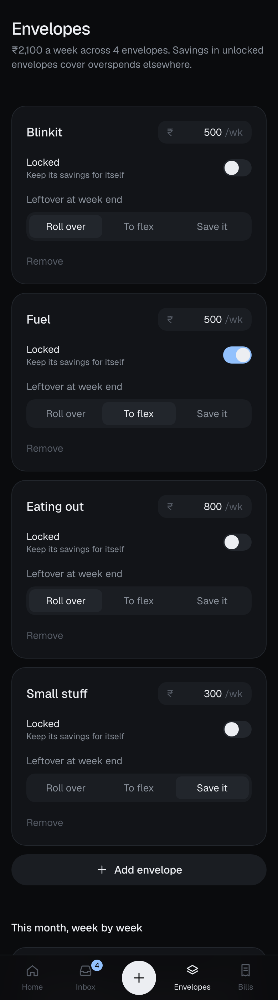

# Spency

A calm spending tracker that helps you end every month with the bank balance you planned, and that Claude keeps up to date for you.

You tell Spency your balance today and the balance you want at month-end. It reserves your fixed bills, splits the rest into weekly envelopes (Blinkit, Fuel, Small stuff…) and a flex pool, and tells you one number every morning: **how much is safe to spend today**.

> Status: **Phase 1 complete, awaiting review.** Every screen and the full budget engine run on a demo month stored in your browser. No accounts or database yet.

<p>
  
  
  
</p>


## What works today

- **Safe to spend today**: envelope money left this week plus a fair share of flex, spread over the days left.
- **Weekly settlement, live**: overspend is covered by savings from unlocked envelopes, then flex, then the month-end target. Home shows "Covered by Blinkit savings" the moment an envelope goes over, with a plain-language summary.
- **Projected month-end** vs target with a small chart, plus flex left, bills still due and bonus saved.
- **Inbox**: swipe right to confirm, left to dismiss, tap to fix amount or category. Duplicates (same UPI ref, or same merchant and amount within 2 minutes) are flagged and kept out of Confirm all.
- **Merchant memory**: recategorize Swiggy once and future Swiggy payments land in the right envelope.
- **Envelopes**: weekly limits, locked envelopes, leftover rules (roll over, to flex, save it), and week-by-week history.
- **Bills**: recurring commitments reserved before anything else.
- **Cash**: withdrawals are transfers, not spending; cash spends still count toward envelopes.
- **Reconcile**: compare with your real bank balance, then find the gap with Claude, log an adjustment or ignore it. Daily streak.
- **Onboarding** in three short steps, and Settings to re-baseline the plan.

## How the numbers work

Everything is derived from the month plan plus confirmed transactions, in integer paise. The engine is plain TypeScript in [`lib/engine`](lib/engine) with no framework imports, covered by Vitest.

- `spendable = bank + cash − target (+ salary due this month)`
- `flex = spendable − bills this month − envelope allocation`
- Envelope allocation is prorated by day: `weekly limit / 7 × days of each week inside the month`. Partial weeks at the start and end of the plan settle on that prorated limit.
- `projected month-end = money now + salary still due − bills still due − envelope money left − unused flex`. If you spend exactly to plan, this equals your target to the rupee.

## Spency as Claude's wallet

The point of Spency is that you don't type in transactions. Claude does.

```
 You ──(UPI screenshot)──▶ Claude chat
                             │  reads merchant, amount, time, UPI ref
                             ▼
                   Spency MCP connector  ──▶  Inbox (pending)
                                                  │ swipe → confirm
                                                  ▼
                                    envelopes · flex · month-end projection
```

1. You add Spency to Claude as a **custom connector** (a remote MCP server hosted on the same Vercel deployment). You sign in once with OAuth, so your Claude is tied to your Spency account.
2. You drop UPI payment screenshots into any Claude chat. Claude extracts the merchant, amount, time and UPI reference, maps them to your envelope names, and calls `add_transactions`.
3. Everything Claude sends lands in your Spency **Inbox** as *pending*. Nothing touches your balances until you swipe to confirm.
4. You can also just ask Claude: *"Can I afford a ₹1,500 dinner tonight?"* It calls `get_summary` and answers from your real numbers.

Spency never sees bank credentials. It only knows what you or Claude tell it.

Planned MCP tools: `get_summary`, `add_transactions` (deduped by UPI ref), `list_transactions`, `update_envelope`, `add_commitment`, `log_cash`, `reconcile`.

## Roadmap

| Phase | What | State |
|---|---|---|
| 1 | All screens + weekly settlement engine on seed data, Vitest coverage | done, in review |
| 2 | Supabase schema, RLS, auth, real data | — |
| 3 | MCP server with OAuth, connector setup guide | — |
| 4 | Pattern detection, rebalance suggestions, polish, accessibility | — |

Full product spec: [SPEC.md](SPEC.md).

## Run it

```bash
npm install
npm run dev        # http://localhost:3000 (opens on a demo month)
npm test           # engine tests
npm run typecheck
npm run lint
```

Stack: Next.js 16 (App Router), React 19, Tailwind CSS 4, Zustand, Vitest. One repo: the same Next.js app serves the UI, the API and (from Phase 3) the MCP server. Dark mode only. Money is stored as integer paise and shown in Indian digit grouping (₹1,00,000), dates in Asia/Kolkata.
