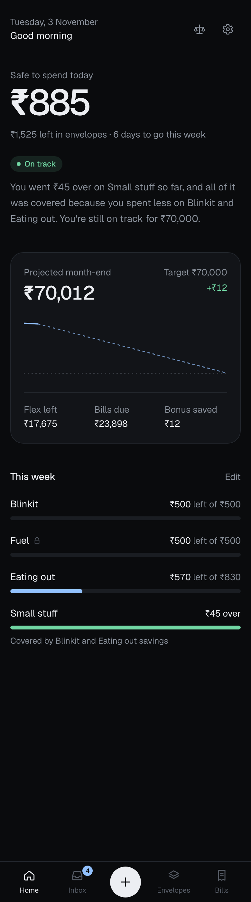
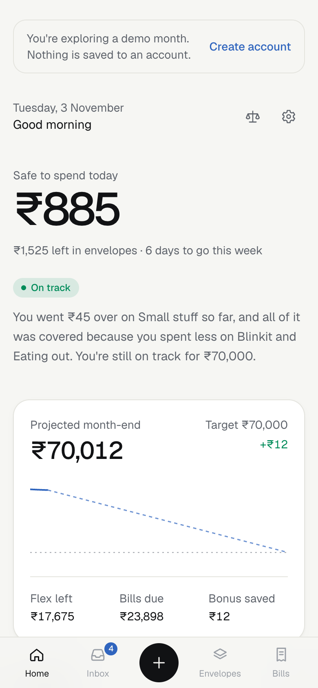
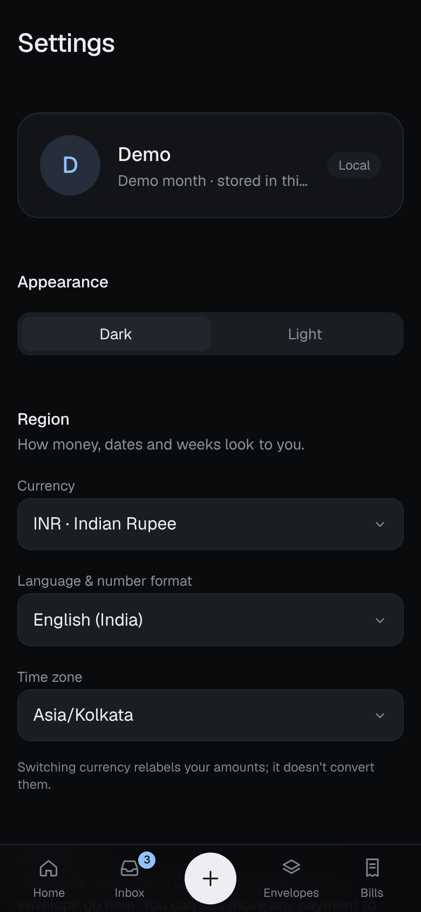
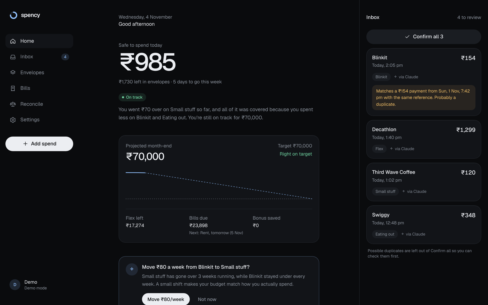

# Spency

A budgeting app for people paid monthly that shows what's safe to spend today and lets Claude log payments from your screenshots.

```bash
git clone https://github.com/apurvamukherjee/spency-pocket-wallet.git && cd spency-pocket-wallet && npm install && npm run dev
```

 <!-- TODO: swap for a 5–10s clip that starts in Claude with a payment screenshot -->

**[Try the live demo](https://spency-pocket-wallet-1ioz.vercel.app/login)** (no account needed: choose "Explore a demo month") · [](https://github.com/apurvamukherjee/spency-pocket-wallet/actions/workflows/ci.yml) [](LICENSE)

<p>
  
  
  
</p>



> **Status:** v0.2.0. All four phases are built and tested end to end; feedback and contributions welcome.

## What it does

You tell Spency your balance today and the balance you want at month-end. It sets aside your bills, splits the rest into weekly envelopes (groceries, eating out, transport…) plus a flex pool, and gives you one number each morning: **how much is safe to spend today**.

- **Overspending is handled for you.** Go over on one envelope and Spency covers it from what you saved in others, then from flex, and only then from your month-end target. It tells you plainly: "You went $15 over on Coffee, and all of it was covered because you spent less on Groceries."
- **Projected month-end** against your target, updated with every payment.
- **Inbox** of payments Claude read from your screenshots. Swipe right to confirm, left to dismiss. Duplicates are flagged.
- **Merchant memory.** Recategorize a shop once; future payments there land in the right envelope.
- **Bills you can tick off.** Mark a bill paid and Spency logs the payment; untick one it assumed was paid and the money is set aside again. Payments can be filed under a bill straight from the Inbox.
- **Nothing lands in Flex by accident.** Payments Spency or Claude can't place go to your default envelope (Small stuff unless you choose another in Settings); Flex is yours to pick.
- **Cash** withdrawals are transfers, not spending. Cash purchases still count toward envelopes.
- **Log or fix any day.** Quick add and the edit sheet take Today, Yesterday or any earlier date, so last night's cash spend lands on the right day.
- **Daily reconcile** against your real bank balance, with a streak.
- **Rebalance suggestions.** If one envelope goes over three weeks running while another stays under, Spency suggests moving money between them, applied in one tap.
- **Start fresh** any time from Settings: a typed-confirmation reset that keeps your account.
- **Works everywhere.** Any currency, number format and time zone. Dark mode by default, light mode in Settings.
- **Private by design.** Spency never asks for bank logins. It only knows what you or Claude tell it.

## Spency as Claude's wallet

The point is that you don't type transactions in. Claude does.

```
 You ──(payment screenshot)──▶ Claude
                                 │  reads merchant, amount, time, reference
                                 ▼
                      Spency connector (MCP) ──▶ Inbox (pending)
                                                    │ swipe to confirm
                                                    ▼
                                    envelopes · flex · month-end projection
```

Spency runs a remote [MCP](https://modelcontextprotocol.io) server at `/api/mcp`. Claude signs in through OAuth (Supabase Auth is the authorization server), so it acts as you and row level security keeps it inside your own data.

| Tool | What Claude can do |
|---|---|
| `get_summary` | Safe to spend today, envelopes, flex, bills, projected month-end. Answers "can I afford this?" |
| `add_transactions` | Send payments read from screenshots to your Inbox as pending. Applies merchant memory, skips duplicates by reference or merchant + amount within 2 minutes. |
| `list_transactions` | Look up payments by date, status or category. |
| `update_envelope` | Change or create an envelope when you ask. |
| `add_commitment` | Add a recurring bill. |
| `log_cash` | Log a cash spend or a withdrawal (pending, like everything Claude adds). |
| `reconcile` | Compare your real bank balance with Spency's and help find the gap. |
| `update_transaction` | Correct any payment, including past days: amount, merchant, category, wallet, date, note. |
| `remove_transaction` | Take a mistaken or duplicate payment out of your balances. |
| `update_commitment` / `remove_commitment` | Change or stop tracking a bill. |
| `set_bill_paid` | "Netflix hasn't gone out yet" or "rent is paid": sets a bill's status for this month. |
| `remove_envelope` | Delete an envelope; its history moves to Flex. |
| `update_plan` | Change your target, pay and pay day, week start, or reset balances to what you have now. |

Claude can't confirm transactions for you: new payments wait in your Inbox until you swipe them in. It can correct or remove existing ones when you ask, and it's told to check with you before removing anything or changing balances.

### Connect it to Claude

1. In Supabase → **Authentication → OAuth Server**: turn on the OAuth server, set **Authorization Path** to `/oauth/consent`, and turn on **Dynamic client registration**.
2. Make sure **Authentication → URL Configuration → Site URL** is your deployed Spency URL.
3. In Claude: **Settings → Connectors → Add custom connector**, name it Spency, URL `https://<your-spency>/api/mcp`. (Settings → Connect Claude in Spency shows the exact URL with a copy button.)
4. Claude opens Spency's consent page. Sign in, review what it can do, and Allow.
5. Drop a payment screenshot into any chat. It shows up in your Inbox.

Disconnect any time in Spency → Settings → Connected apps.

## Run it

**Demo mode (no setup):** `npm install && npm run dev`, then open http://localhost:3000. You get a sample month stored in your browser.

**With accounts:** Spency uses [Supabase](https://supabase.com) for Postgres and auth.

1. Create a free Supabase project.
2. `cp .env.example .env.local` and fill in `SUPABASE_URL` and `SUPABASE_PUBLISHABLE_KEY` (Project Settings → API).
3. Apply the schema:
   ```bash
   npx supabase login
   npx supabase link --project-ref <your-project-ref>
   npx supabase db push --remote
   ```
4. In Supabase → Authentication → URL Configuration, set the Site URL and add `<your-site>/auth/confirm` to the redirect URLs.
5. `npm run dev`, then create an account.

```bash
npm test           # engine tests
npm run typecheck
npm run lint
npm run build
```

## Deploy to Vercel

1. Import the GitHub repo in Vercel (framework: Next.js, root `./`, Node 20+).
2. Project → Settings → Environment Variables, for Production, Preview and Development:

   | Name | Value |
   |---|---|
   | `SUPABASE_URL` | `https://<project-ref>.supabase.co` |
   | `SUPABASE_PUBLISHABLE_KEY` | the **publishable** key (never the secret / service_role key) |
   | `NEXT_PUBLIC_SITE_URL` | optional, only for a custom domain |

   The `NEXT_PUBLIC_` versions of the Supabase names work too. Values are read at build time, so redeploy after changing them.
3. Supabase → **Authentication → URL Configuration**: Site URL = your Vercel URL; add `https://<your-domain>/**` to Redirect URLs.
4. Supabase → **Authentication → Emails**: paste [`supabase/templates/confirmation.html`](supabase/templates/confirmation.html) into *Confirm signup* and [`recovery.html`](supabase/templates/recovery.html) into *Reset password*. Their links work on any device.
5. Supabase → **Authentication → OAuth Server**: enable it, Authorization Path `/oauth/consent`, dynamic client registration on (for the Claude connector).
6. Apply the schema once: `npx supabase link --project-ref <ref>` then `npx supabase db push --remote`.

Every push to `main` deploys. Check a deploy by opening the site (you should see "Welcome back", not "Accounts aren't set up here") and `https://<your-domain>/.well-known/oauth-protected-resource/api/mcp`, which should name your Supabase project.

The built-in Supabase email sender is rate-limited; for real users, set up custom SMTP in Authentication → Emails.

## How the numbers work

Everything shown is derived from the month plan plus confirmed transactions, in integer minor units (cents, paise, yen). The engine is plain TypeScript in [`lib/engine`](lib/engine) with no framework imports, covered by Vitest.

- `spendable = bank + cash − target (+ pay still due this month)`
- `flex = spendable − bills this month − envelope allocation`
- Envelope allocation is prorated by day: `weekly limit / 7 × days of each week inside the month`, rounded to a whole unit of your currency.
- `projected month-end = money now + pay still due − bills still due − envelope money left − unused flex`. If you spend exactly to plan, this equals your target.

## Architecture

One Next.js 16 app serves the UI, the server actions and the MCP server.

| Layer | Where | Notes |
|---|---|---|
| Budget engine | `lib/engine/` | Pure functions: settlement, projection, proration, money formatting. |
| Data | `lib/data/` | Pure reducers shared by the local demo (Zustand) and the cloud (TanStack Query + Supabase, optimistic). |
| Database | `supabase/migrations/` | Postgres with row level security on every table; composite keys stop cross-user references. |
| Auth | `app/(auth)/`, `proxy.ts` | Email and password through Supabase; the proxy refreshes the session cookie. |
| Claude connector | `app/api/mcp/`, `lib/mcp/`, `app/(auth)/oauth/consent/` | MCP tools over Streamable HTTP (`mcp-handler`), OAuth 2.1 via Supabase Auth, consent screen. |
| UI | `app/(app)/`, `components/` | Tailwind CSS 4, hand-drawn icons and charts, native `<dialog>` sheets. |

## Roadmap

| Phase | What | State |
|---|---|---|
| 1 | Screens and weekly settlement engine on local data | done |
| 2 | Supabase schema, row level security, accounts, sync, any currency, light theme | done |
| 3 | MCP server with OAuth, Claude connector setup guide | done |
| 4 | Pattern detection, rebalance suggestions, recent activity, hard reset, accessibility, deployment notes | done |

The full product spec is in [SPEC.md](SPEC.md) and the changes are in [CHANGELOG.md](CHANGELOG.md).

## Brand assets

The mark is a ring three-quarters full: on track. Sources live in [`docs/brand/`](docs/brand): `mark.svg`, `app-icon.html` (square app icons) and `share-card.html` (link previews), rendered to PNG with headless Chrome. Next.js picks up the tab icon, Apple touch icon, manifest and share images from `app/` automatically.

## Contributing

Issues and pull requests are welcome. Start with [CONTRIBUTING.md](CONTRIBUTING.md). Questions go to [Discussions](https://github.com/apurvamukherjee/spency-pocket-wallet/discussions).

## License

[MIT](LICENSE) © Apurva Mukherjee
